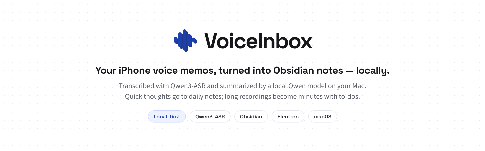
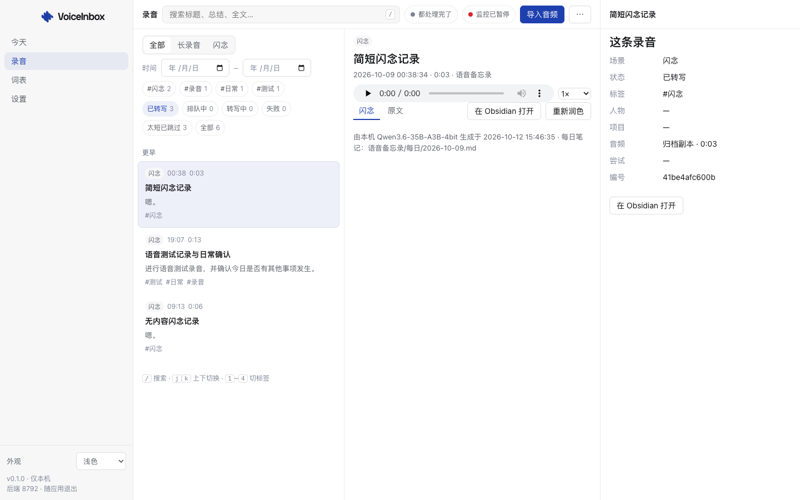
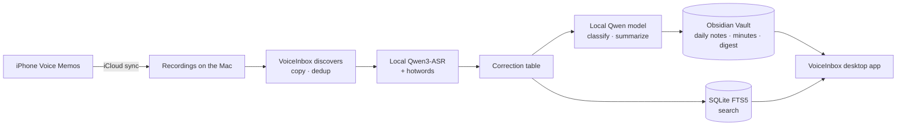
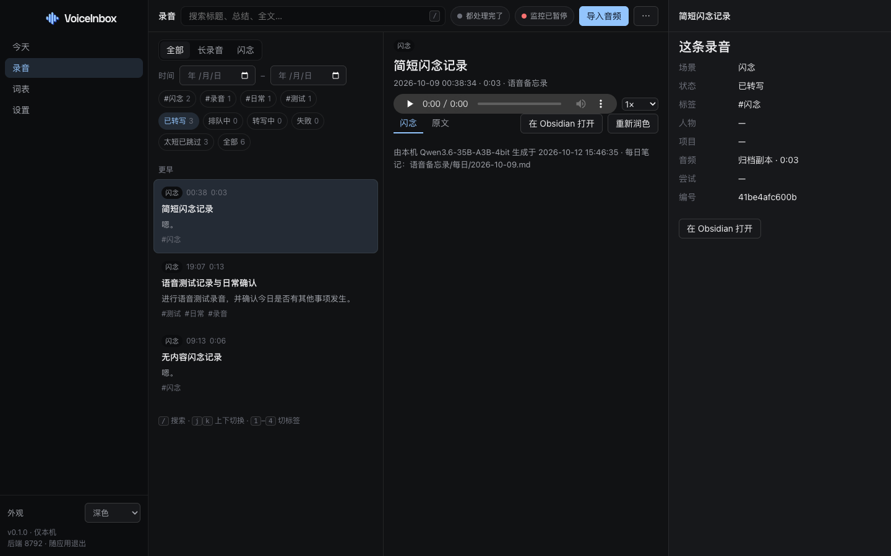
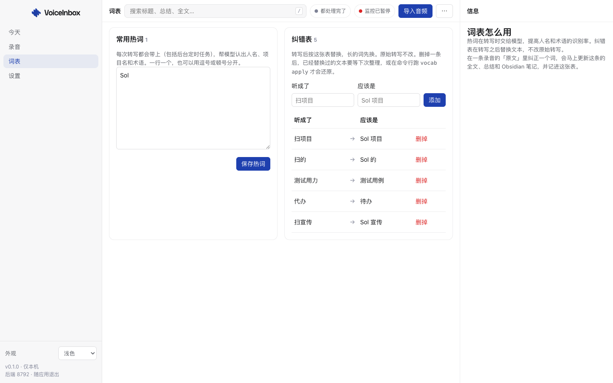
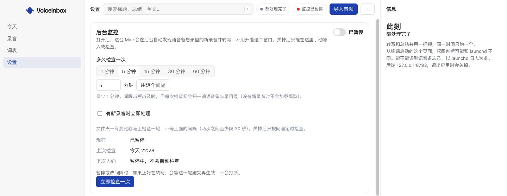
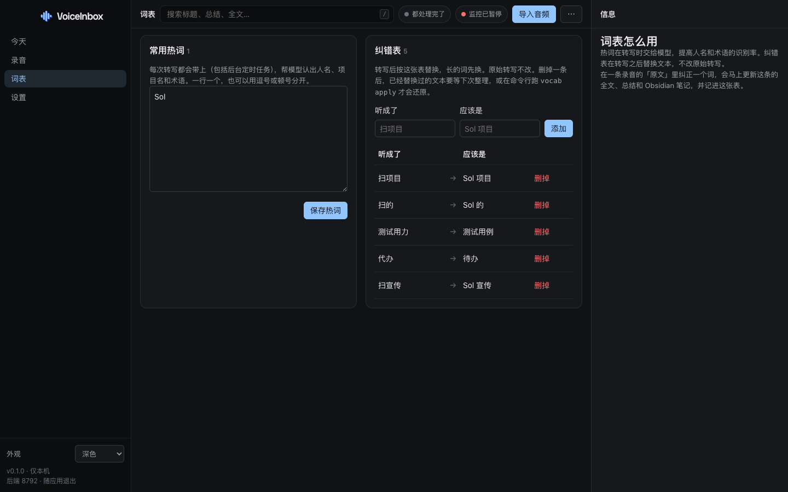

<div align="center">



**English** · [简体中文](README.zh-CN.md)

**Your iPhone voice memos, turned into Obsidian notes — locally.**<br>
Transcribed on your Mac with Qwen3-ASR, then classified and summarized by a local Qwen model and written to your Obsidian Vault. Nothing is uploaded to the cloud.

[](#license)
[](pyproject.toml)
[](package.json)
[](#requirements)
[](https://github.com/WYgao29/VoiceInbox/commits/main)



</div>

## Contents

[Why](#why) · [Features](#features) · [How it works](#how-it-works) · [Quickstart](#quickstart) · [Screenshots](#screenshots) · [Privacy](#privacy) · [FAQ](#faq) · [Roadmap](#roadmap) · [License](#license)

## Why

Voice memos pile up and are rarely replayed: they're hard to find, impossible to search, and never become to-dos. Cloud transcription means sending private recordings away.

VoiceInbox does the whole job on your own Mac: iCloud syncs your recordings, VoiceInbox picks up new ones, transcribes and organizes them locally, writes Obsidian notes, and indexes everything for search.

## Features

| | Feature | Details |
|---|---|---|
| 🎙️ | **Automatic discovery** | Reads iCloud-synced Voice Memos read-only, copies before processing, never modifies or deletes originals; manual import too. Content-hash dedup. |
| 🧠 | **Local transcription** | Runs the locally deployed Qwen3-ASR-1.7B (MLX), forced offline. |
| ✍️ | **Quick thoughts & minutes** | Short clips (≤120 s by default) are polished and appended to the daily note; long recordings are classified (meeting, interview, lecture, call, musing…) and summarized with overview, key points, decisions, to-dos and a mind map. |
| 📚 | **Hotwords & corrections** | Hotwords guide recognition of names and terms; a correction table rewrites text after transcription while the raw transcript is kept. |
| 📝 | **Obsidian output** | Frontmatter and wikilinks; only a managed block is rewritten, your own edits are kept, with backups before overwrite. |
| 🗓️ | **Daily digest** | An evening summary of the day; the Today view browses dates and gathers all open to-dos. |
| 🔍 | **Full-text search** | SQLite FTS5 with date filters and highlighted hits. |
| 🗑️ | **Delete recordings** | Delete one or several recordings, including app copies and generated Obsidian content. Originals and handwritten content are kept; affected daily digests are rebuilt. |
| ⏱️ | **Background monitoring** | A macOS launchd job processes new recordings at login, on folder changes and on a timer; one model task at a time. |
| 🖥️ | **Mac desktop app** | Electron + React + TypeScript: Recordings, Today, Vocabulary and Settings, light/dark themes and keyboard shortcuts. |

## How it works



## Quickstart

### Requirements

- macOS on Apple Silicon (Qwen3-ASR and the Qwen model run locally; ~9.6 GB peak memory while transcribing)
- Python 3.11+, Node.js, `ffmpeg`
- A local Qwen3-ASR install and an oMLX server providing the local Qwen model
- Voice Memos enabled in iCloud on both iPhone and Mac
- Obsidian (recommended for reading the notes)

### Install

```bash
git clone https://github.com/WYgao29/VoiceInbox.git
cd VoiceInbox
npm install
uv venv .venv && uv pip install --python .venv/bin/python -r requirements-dev.txt
```

Paths and pipeline settings live in `config.toml`. Copy `config.example.toml` to `config.toml` and edit the paths. `config.toml` stays out of git.

### Open the desktop app

```bash
npm run package:mac
open "release/VoiceInbox-darwin-arm64/VoiceInbox.app"
```

For development: `npm run dev:desktop`. The app starts the Python backend on `127.0.0.1` (port 8791 by default).

> **Note:** the packaged app does not bundle the Python backend and is not signed or notarized. Keep it inside the repo's `release/` folder so it can find the repo, or set `VOICEINBOX_ROOT` to the repo root before moving it.

### Background monitoring

Monitoring runs as a launchd job. Reading Voice Memos needs Full Disk Access, granted only to the dedicated Python copy the script builds:

```bash
bash scripts/install_launchd.sh     # build the dedicated Python copy and install the job
bash scripts/uninstall_launchd.sh   # remove the job, keep your data
```

Then use Settings in the app to toggle monitoring, change the interval or run a check now. Runtime data (transcripts, state, logs, vocabulary) lives in `~/VoiceInbox`, outside git.

## Screenshots

| Recordings (dark) | Vocabulary |
|---|---|
|  |  |
| **Settings: background monitoring** | **Vocabulary (dark)** |
|  |  |

The UI is in Simplified Chinese.

## Privacy

- Recordings, transcripts and summaries are processed on your Mac and never uploaded.
- Transcription runs forced-offline; summaries use a local model server.
- The Voice Memos folder is read-only; originals are never modified or deleted.
- The backend listens on `127.0.0.1` only; state-changing requests require a CSRF token.
- No API keys in the repo; runtime data stays in `~/VoiceInbox`, outside git.

## FAQ

<details><summary><b>Does it need the internet or a cloud API?</b></summary>

No. Download the models once; transcription and summaries then run locally.
</details>

<details><summary><b>Why Full Disk Access?</b></summary>

macOS keeps Voice Memos data in a protected folder. VoiceInbox grants access only to a dedicated Python copy in the repo — not to Terminal, Electron or your shared Python.
</details>

<details><summary><b>Will it overwrite my edits in Obsidian?</b></summary>

No. It only rewrites its own managed block; everything outside is kept, and a backup is made before each overwrite.
Deletion removes generated content without making a new backup. Existing backups and logs are kept. Deleted audio is skipped during automatic scans, even after renaming; explicitly importing it again allows reprocessing.
</details>

<details><summary><b>Which languages?</b></summary>

Chinese by default; change the language in Settings or leave it empty for auto-detection.
</details>

## Roadmap

- [ ] Word/sentence timestamps for precise jump-to-audio
- [ ] Chinese inverse text normalization (ITN)
- [ ] Speaker diarization
- [ ] Bundled backend, signed and notarized app

## License

TBD.
