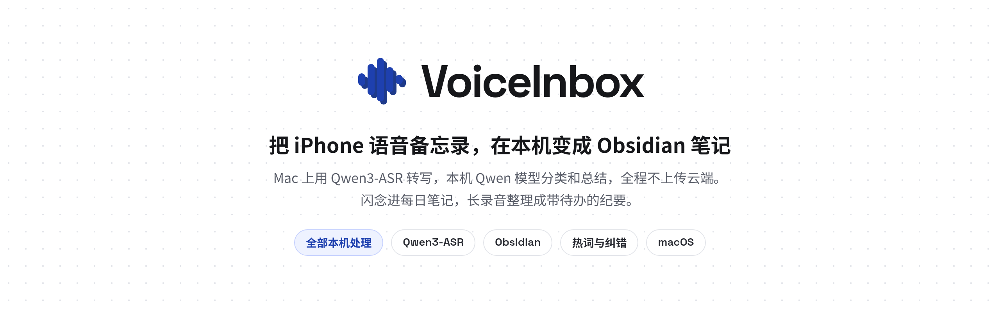
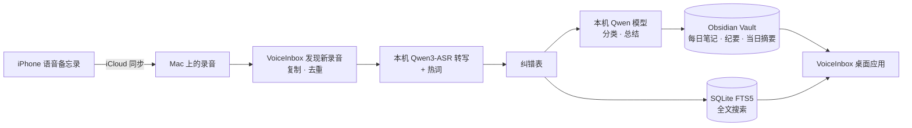

<div align="center">



[English](README.md) · **简体中文**

**把 iPhone 语音备忘录，在本机变成 Obsidian 笔记。**<br>
在 Mac 上用 Qwen3-ASR 转写，再用本机 Qwen 模型分类、总结，写进你的 Obsidian Vault。全程不上传云端。

[](#许可证)
[](pyproject.toml)
[](package.json)
[](#环境要求)
[](https://github.com/WYgao29/VoiceInbox/commits/main)


</div>

## 目录

[为什么做](#为什么做) · [功能](#功能) · [工作流程](#工作流程) · [安装与使用](#安装与使用) · [截图](#截图) · [隐私](#隐私) · [常见问题](#常见问题) · [后续计划](#后续计划) · [许可证](#许可证)

## 为什么做

随手录的语音备忘录很多，回头却很少再听：找不到、不好搜，也没法变成待办。交给云端服务转写，又要把私人录音传出去。

VoiceInbox 在你自己的 Mac 上完成整件事：iCloud 把录音同步到 Mac，它自动发现新录音，本机转写、整理，写成 Obsidian 笔记，并建好全文索引。

## 功能

| | 功能 | 说明 |
|---|---|---|
| 🎙️ | **自动发现新录音** | 只读访问 iCloud 同步来的「语音备忘录」，复制一份再处理，不改、不删原文件；也可以把音频手动导入。按内容哈希去重。 |
| 🧠 | **本机转写** | 调用本机部署的 Qwen3-ASR-1.7B（MLX），强制离线运行。 |
| ✍️ | **闪念与纪要** | 短录音（默认 ≤120 秒）作为「闪念」润色后追加到当天的每日笔记；长录音先分场景（会议、访谈、课程、通话、随想等），再写出概要、分段要点、决策、待办和思维导图。 |
| 📚 | **热词与纠错表** | 热词在转写时交给模型，提高人名和术语的识别率；纠错表在转写之后替换文本，原始转写保留不动。 |
| 📝 | **写入 Obsidian** | 带 frontmatter 和 wikilink；只改受管区块，你在笔记里手写的内容会保留，覆盖前先备份。 |
| 🗓️ | **每日摘要** | 每天晚上自动生成当日摘要；「今天」页可以前后翻日期，并汇总所有未完成的待办。 |
| 🔍 | **全文搜索** | SQLite FTS5 全文搜索，可限定时间范围，命中高亮。 |
| 🗑️ | **删除录音** | 单条或批量清理应用持有的音频、转写、总结及 Obsidian 生成内容；保留苹果和外部导入原件、手写内容，受影响日期的摘要自动重建。 |
| ⏱️ | **后台监控** | 通过 macOS launchd 在登录后、录音目录变化时和定时兜底时处理新录音；同一时间只跑一个模型任务。 |
| 🖥️ | **Mac 桌面应用** | Electron + React + TypeScript 编写，录音、今天、词表、设置四个页面，支持浅色/深色和键盘快捷键。 |

## 工作流程



## 安装与使用

### 环境要求

- macOS，Apple Silicon（本机运行 Qwen3-ASR 和 Qwen 模型，转写时峰值内存约 9.6 GB）
- Python 3.11+、Node.js、`ffmpeg`
- 本机已部署 Qwen3-ASR，以及提供本机 Qwen 模型的 oMLX 服务
- iPhone 和 Mac 都在 iCloud 里打开「语音备忘录」
- Obsidian（推荐，用来阅读生成的笔记）

### 安装

```bash
git clone https://github.com/WYgao29/VoiceInbox.git
cd VoiceInbox
npm install
uv venv .venv && uv pip install --python .venv/bin/python -r requirements-dev.txt
```

路径和处理参数在 `config.toml` 里。先把 `config.example.toml` 复制成 `config.toml`，再改其中的路径。`config.toml` 不进 git。

### 打开桌面应用

```bash
npm run package:mac
open "release/VoiceInbox-darwin-arm64/VoiceInbox.app"
```

开发时也可以用 `npm run dev:desktop`。应用启动时会在本机 `127.0.0.1` 上自动拉起 Python 后端（默认端口 8791）。

> **注意**：当前打出来的 App 没有捆绑 Python 后端，也没有签名和公证。请让它留在仓库的 `release/` 目录里，它会从所在位置找到仓库；要挪到别处，需要先设置环境变量 `VOICEINBOX_ROOT` 指向仓库根目录。

### 开启后台监控

后台监控由 launchd 任务完成。读取「语音备忘录」需要「完全磁盘访问」，只授权给仓库里专门生成的 Python 副本即可：

```bash
bash scripts/install_launchd.sh     # 生成专用 Python 副本并安装 launchd 任务
bash scripts/uninstall_launchd.sh   # 卸载任务，不删除数据
```

装好后，在应用的「设置」里可以开关监控、调整检查间隔、点「立即检查一次」。

运行数据（转写、状态库、日志、词表）放在 `~/VoiceInbox`，不进 git。

## 截图

| 录音（深色） | 词表 |
|---|---|
|  |  |
| **设置：后台监控** | **词表（深色）** |
|  |  |

## 隐私

- 录音、转写、总结都在你的 Mac 上完成，不上传任何云端服务。
- 转写模型强制离线运行；总结用的是本机模型服务。
- 「语音备忘录」原目录只读，原文件不改、不删。
- 后端只监听 `127.0.0.1`，改设置等操作需要 CSRF 令牌。
- 仓库里不存放任何 API key；运行数据在 `~/VoiceInbox`，不进 git。

## 常见问题

<details><summary><b>需要联网或云端 API 吗？</b></summary>

不需要。模型需要事先下载到本机，之后转写和总结都在本机完成。
</details>

<details><summary><b>为什么要「完全磁盘访问」？</b></summary>

macOS 把「语音备忘录」的数据放在受保护的目录里。VoiceInbox 只把权限授给仓库里专门生成的 Python 副本，不需要授给终端、Electron 或公用的 Python。
</details>

<details><summary><b>改了 Obsidian 笔记会被覆盖吗？</b></summary>

不会。程序只改它自己管理的那一块，块外你手写的内容会保留；每次覆盖前都会先备份。
删除时直接清理生成内容，不新增备份；已有备份和日志保留。自动扫描会跳过已删除的音频，即使文件改名也不会再次导入；主动导入同一音频则会重新处理。
</details>

<details><summary><b>支持哪些语言？</b></summary>

默认按中文转写，可以在设置里改语言，或留空让模型自己判断。
</details>

## 后续计划

- [ ] 词级或句级时间戳，让「跳到音频」更准
- [ ] 中文数字规整（ITN）
- [ ] 说话人分离
- [ ] App 捆绑后端，并签名、公证

## 许可证

待定。
